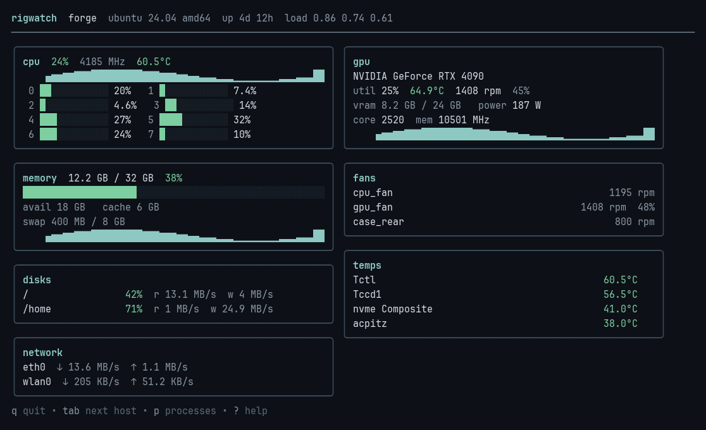
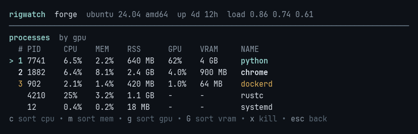
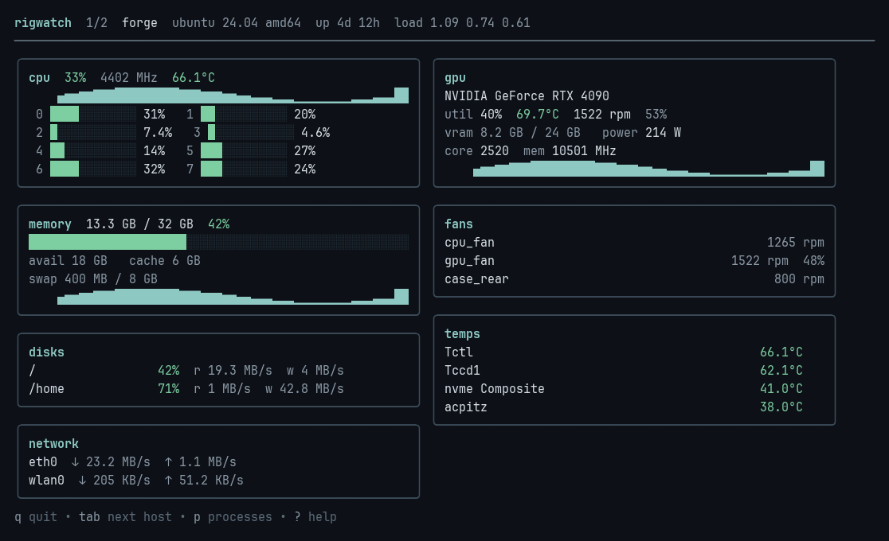
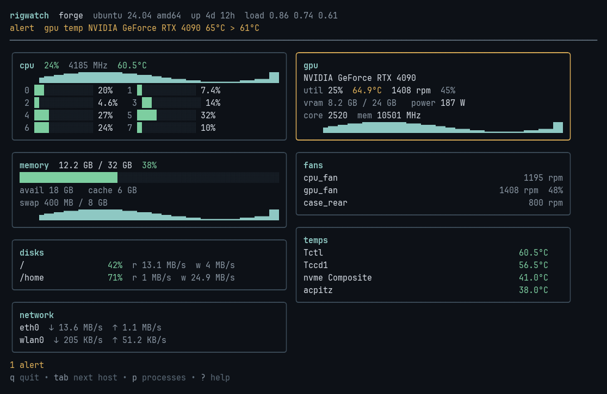

# rigwatch

Terminal monitor for CPU, GPU, memory, disks, network, temperatures, fans, and the busiest processes. It watches this machine, or other hosts over SSH and WebSocket. A missing sensor stays on screen with a short hint.



*Dashboard from `rigwatch --demo`.*



*Processes (`p`), sorted by GPU (`g`). Ranks 1–3 follow the current sort. GPU and VRAM show when a process reports them.*



*Two hosts (`rigwatch connect`). The header shows `1/2`. `tab` switches machines.*



*Alert banner from `rigwatch --demo --temp-amber 61`. The GPU card takes the amber border, and the footer counts `1 alert`.*

## Install

```bash
go install github.com/tushar1210/rigwatch@latest
```

Prebuilt binaries for macOS, Linux, and Windows (`amd64` and `arm64`) are on the [v0.3.0 release](https://github.com/tushar1210/rigwatch/releases/tag/v0.3.0). SHA256 checksums are in [`checksums.txt`](https://github.com/tushar1210/rigwatch/releases/download/v0.3.0/checksums.txt).

| | amd64 | arm64 |
| --- | --- | --- |
| Linux | [tar.gz](https://github.com/tushar1210/rigwatch/releases/download/v0.3.0/rigwatch_0.3.0_linux_amd64.tar.gz) | [tar.gz](https://github.com/tushar1210/rigwatch/releases/download/v0.3.0/rigwatch_0.3.0_linux_arm64.tar.gz) |
| macOS | [tar.gz](https://github.com/tushar1210/rigwatch/releases/download/v0.3.0/rigwatch_0.3.0_darwin_amd64.tar.gz) | [tar.gz](https://github.com/tushar1210/rigwatch/releases/download/v0.3.0/rigwatch_0.3.0_darwin_arm64.tar.gz) |
| Windows | [zip](https://github.com/tushar1210/rigwatch/releases/download/v0.3.0/rigwatch_0.3.0_windows_amd64.zip) | [zip](https://github.com/tushar1210/rigwatch/releases/download/v0.3.0/rigwatch_0.3.0_windows_arm64.zip) |

## Usage

This machine:

```bash
rigwatch
rigwatch --interval 2s
rigwatch --json     # one JSON snapshot, then exit
rigwatch --demo     # synthetic vitals, no sensors required
```

Other machines. `tab` and `shift+tab` move between hosts.

```bash
rigwatch connect ssh://user@host
rigwatch connect forge:7777 atlas:7777 --token "$RIGWATCH_TOKEN"
```

`ssh://` does not open a port. The client runs `rigwatch agent --stdio` on the remote host with your usual keys and `~/.ssh/config`. The remote binary must be on `PATH` for a non-interactive session, or pass `--remote-bin`.

Publish samples for those clients (WebSocket `/ws`, SSE `/api/stream`, one shot `/api/snapshot`):

```bash
rigwatch agent --listen :7777
rigwatch agent --listen :7777 --token "$RIGWATCH_TOKEN"
```

## Keys

| Key | Action |
| --- | --- |
| `q`, `ctrl+c` | Quit |
| `esc` | Close the overlay, or quit |
| `tab` / `shift+tab` | Next / previous host |
| `p` | Processes |
| `j` / `k`, arrows | Select a process |
| `c` | Sort by CPU |
| `m` | Sort by memory (RSS; working set on Windows) |
| `g` | Sort by GPU utilization |
| `G` | Sort by GPU memory |
| `x`, then `y` | SIGTERM the selected process |
| `x`, then `9`, then `y` | SIGKILL |
| `n` | Cancel the kill prompt |
| `?` | Help |

The top three rows for the current sort are marked 1–3.

`x` asks before it signals, and only on the machine you are sitting at. `--demo` and `rigwatch connect` do not send a signal. macOS and Linux need you to own the process (or root); otherwise the row says `access denied` and the process keeps running. Windows uses `taskkill`, and `9` adds `/F`.

## Alerts

Copy [`rigwatch.example.yaml`](rigwatch.example.yaml). Flags override the file. Lookup is `--config`, then `$RIGWATCH_CONFIG`, then `~/.config/rigwatch/config.yaml` when that file exists.

Thresholds color the panels and fire when a reading crosses them: temperature (`temp_amber` / `temp_red`), CPU, memory, GPU, disk, and fan. CPU and GPU temperatures follow the shared limits unless `cpu_temp_*` or `gpu_temp_*` is set. `fan_rpm_warn: 0` leaves RPM off. `metrics` limits which signals are watched.

The baseline is the mean of samples inside `window`, excluding the current point. It alerts when a reading stays above that mean by the margin (`margin_percent`, `margin_temp`, or `margin_rpm`) for `sustain`. Disks use the fixed percent only. `min_samples` is how many points the mean needs first.

The TUI draws a one-line banner, a status count, and highlights the panel. It rings the bell and runs `command` when those are set. The same alert waits until the reading recovers and `cooldown` has passed (default 2m). Amber rising to red still notifies. The banner clears on recovery. `cooldown: 0` re-arms as soon as the reading recovers.

The agent writes `{"type":"alert","alert":{...}}` on stdio and WebSocket, and `event: alert` on SSE, and runs `command` too. Snapshot frames stay as they are. The command sees `RIGWATCH_HOST`, `RIGWATCH_KEY`, `RIGWATCH_LEVEL`, `RIGWATCH_KIND`, `RIGWATCH_METRIC`, `RIGWATCH_VALUE`, and `RIGWATCH_LIMIT`. The TUI and the agent each run it, so set the command on the side that should notify.

## Platforms

macOS, Windows, and Linux.

| | Linux | macOS | Windows |
| --- | --- | --- | --- |
| CPU, memory, disks, network, processes | yes | yes | yes |
| Temperatures and fans | hwmon | SMC, no sudo | LibreHardwareMonitor, or ACPI zones as admin |
| NVIDIA GPU | NVML or `nvidia-smi` | `nvidia-smi` when a driver is installed | `nvml.dll` or `nvidia-smi`, no extra setup |
| AMD / Intel GPU | DRM sysfs | — | LibreHardwareMonitor |
| Apple GPU | — | `ioreg` and SMC | — |

### Windows

CPU, memory, disks, network, and processes need no extra software. NVIDIA cards are read from `nvml.dll` and `nvidia-smi.exe` the same way.

Stock Windows APIs do not expose package temperature or fan RPM. For those, run [LibreHardwareMonitor](https://github.com/LibreHardwareMonitor/LibreHardwareMonitor) and turn on its WMI provider or the web server at `http://127.0.0.1:8085/data.json` (`--lhm-url` overrides that). If it is not running, the card says `start LibreHardwareMonitor`.

## Develop

```bash
gofmt -w .
gofmt -l .
go test ./...
```

Release binaries are `CGO_ENABLED=0` builds for the six targets in [`.goreleaser.yaml`](.goreleaser.yaml).

## License

MIT. See [LICENSE](LICENSE).
